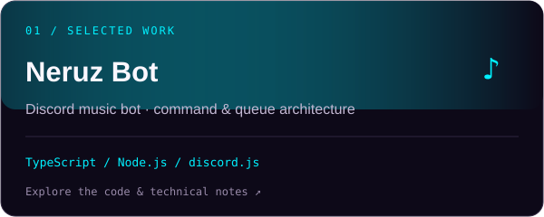
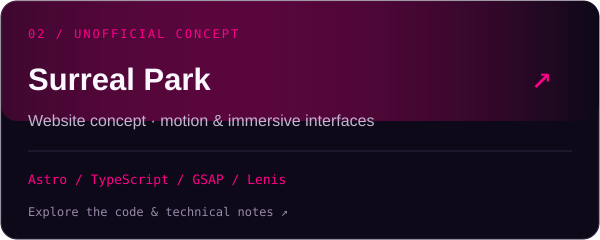

  

  <a href="https://fontedev.com"><strong>Portfolio ↗</strong></a> &nbsp; / &nbsp;
  <a href="https://www.linkedin.com/in/brunolucassf"><strong>LinkedIn ↗</strong></a> &nbsp; / &nbsp;
  <a href="https://www.instagram.com/fonte.dev/"><strong>Instagram ↗</strong></a> &nbsp; / &nbsp;
  <a href="https://github.com/brunolucassf/brunolucassf/blob/main/README.md">Português 🇧🇷</a>

### A little context

I'm **Bruno**, a developer based in southern Brazil, building under **Fonte Dev**. My work spans websites, web applications and automation — with a particular interest in the place where engineering meets visual design.

I work with **React, Next.js, TypeScript and Node.js**, alongside a background in **WordPress and WooCommerce**. I care about responsive interfaces, performance, clear structure and the small details that make software feel good to use.

### Selected work

<table>
<tr>
<td width="50%" valign="top">

A music bot with prefix and slash commands, per-server queues and a layered architecture. The public repository documents the design and includes selected code; the playback core is private.

<a href="https://github.com/brunolucassf/NeruzBot">Repository &amp; architecture</a> · <a href="https://neruz.cloud">Live website ↗</a>
</td>
<td width="50%" valign="top">

An independent, unofficial website concept based on publicly available information. Not commissioned, endorsed by or affiliated with Surreal Park. Explores immersive art direction, motion and scrolling interactions. Built with static Astro, strict TypeScript and a custom CSS design system.

<a href="https://github.com/brunolucassf/surreal-park-v2">Repository &amp; setup</a>
</td>
</tr>
</table>

More websites and interface work live at **[fontedev.com ↗](https://fontedev.com)**.

### Toolbox

| Area | Technologies |
| :--- | :--- |
| Interfaces | React · Next.js · TypeScript · JavaScript · HTML · CSS |
| Backend & automation | Node.js · API integrations · Discord bots |
| Web platforms | WordPress · WooCommerce · Elementor |
| Workflow & design | Git · GitHub · Figma · Photoshop · Illustrator |

### Currently exploring

**React Native**, **Java backend development** and **AI agent architecture** — learning by building, testing ideas and documenting the process.

### How I approach a build

- Start with the problem and the people using the software.
- Design for small screens and pay attention to loading and interaction.
- Keep responsibilities clear and validate what crosses system boundaries.
- Use motion to support the experience, then iterate on the details.

---

<code>Curiosity → code → something useful.</code> Bruno Lucas · Fonte Dev · Brazil

