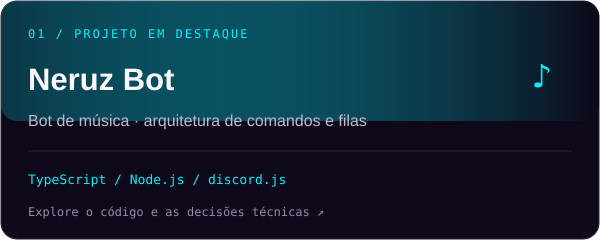

  

  <a href="https://fontedev.com"><strong>Portfólio ↗</strong></a> &nbsp; / &nbsp;
  <a href="https://www.linkedin.com/in/brunolucassf"><strong>LinkedIn ↗</strong></a> &nbsp; / &nbsp;
  <a href="https://www.instagram.com/fonte.dev/"><strong>Instagram ↗</strong></a> &nbsp; / &nbsp;
  <a href="https://github.com/brunolucassf/brunolucassf/blob/main/README.en.md">English 🇬🇧</a>

### Um pouco de contexto

Sou **Bruno Lucas**, desenvolvedor no sul do Brasil e autor da **Fonte Dev**. Construo sites, aplicações web e automações, com interesse especial no encontro entre engenharia e design visual.

Trabalho com **React, Next.js, TypeScript e Node.js**, além da experiência com **WordPress e WooCommerce**. Valorizo interfaces responsivas, performance, organização do código e os detalhes que tornam um produto agradável de usar.

### Projetos em destaque

<table>
<tr>
<td width="50%" valign="top">

Bot de música com comandos de prefixo e barra, filas por servidor e arquitetura em camadas. O repositório público apresenta a arquitetura e partes selecionadas do código; o núcleo de reprodução é privado.

<a href="https://github.com/brunolucassf/NeruzBot">Repositório e arquitetura</a> · <a href="https://neruz.cloud">Site do projeto ↗</a>
</td>
<td width="50%" valign="top">

<strong>Conceito independente e não oficial</strong>, desenvolvido com informações públicas, sem contratação, endosso ou vínculo com o Surreal Park. Explora direção de arte imersiva, animações e interações de rolagem. Desenvolvido com Astro estático, TypeScript estrito e um sistema visual próprio em CSS.

<a href="https://github.com/brunolucassf/surreal-park-v2">Repositório e como executar</a>
</td>
</tr>
</table>

Mais sites e interfaces no **[fontedev.com ↗](https://fontedev.com)**.

### Ferramentas

| Área | Tecnologias |
| :--- | :--- |
| Interfaces | React · Next.js · TypeScript · JavaScript · HTML · CSS |
| Backend e automação | Node.js · Integrações com APIs · Bots para Discord |
| Plataformas web | WordPress · WooCommerce · Elementor |
| Fluxo e design | Git · GitHub · Figma · Photoshop · Illustrator |

### Em estudo

**React Native**, **desenvolvimento backend com Java** e **arquitetura de agentes de IA**, aprendendo ao construir, testar ideias e documentar o processo.

### Como trabalho

- Entender o problema e quem vai usar o software.
- Projetar para telas pequenas e cuidar do carregamento e das interações.
- Separar responsabilidades e validar os dados nas fronteiras do sistema.
- Usar movimento com propósito e refinar os detalhes.

---

<code>Curiosidade → código → algo útil.</code> Bruno Lucas · Fonte Dev · Brasil

